# Otto

**An agentic development environment.** Otto is a macOS desktop app that runs
coding-agent CLIs (Claude Code, Codex, and others) as first-class, openable
sessions — and wires them into the rest of your workflow: git & pull requests,
multi-agent code review, Jira/Confluence product workflows, SSH/database
connections, an HTTP API client, real token-usage tracking, and Slack/Telegram
bridges so an agent can work a ticket from a chat thread.

**Version 0.7.0** · macOS (Apple Silicon; Intel from source) · actively developed, so
expect rough edges. Prebuilt builds: see [Download](#download-prebuilt-dmg).

🎬 **[Watch the product tour](https://github.com/itzikiusa/otto_os/releases/download/walkthroughs/otto-tour-20261126.mp4)**
(3 minutes, Otto 0.7.0; also in the app under **Help → Walkthroughs**).

### What's new in 0.7.0

- **Workflows, rebuilt around runs.** Workflows opens on **Runs**: *Needs
  you*, *Running* and *Recent*, each run in words: what it is about, what it
  is doing, why it waits. A run has its own page with one ring for progress,
  every step in the order it ran (steps that ran side by side are grouped
  under *In parallel*), a failed step's own error first with **Retry step**,
  and each agent step's conversation beside the list. **Pause**, **Resume**,
  *Skip this step* and *Add a note for the next step…* work while it runs. The
  same pages work on the phone, with touch.
- **Zig in the IDE.** Zig projects (`build.zig`) get what the other languages
  have: highlighting, toolchain detection and Otto's own installer, `zls`
  (SHA-256 verified via zigtools' release selector) for completion and
  navigation, run configurations and gutter Run / Debug on `main` and on tests,
  and debugging with breakpoints, stepping, watch, set variable and stops on
  `@panic`, with slices, optionals and error unions shown as values. `zls`
  runs the project's `build.zig`, so it starts only after you trust the
  project (see the language-server note below).
- **C / C++, Unreal Engine, Kotlin, Spring Boot, .NET and web frameworks in the
  IDE.** C / C++ & Unreal Engine get highlighting, `clangd` with auto
  `--compile-commands-dir` and `⌥O` header/source switch, CMake / Presets /
  CTest / Meson / Make / Unreal run configs, GoogleTest & Catch2 gutter runs,
  `vcpkg`/`conan`/CMake/`.uproject` inspection, and LLDB debugging (STL &
  Unreal formatters, exception breakpoints, PID/process-name attach and core
  dumps). Kotlin & Spring Boot get Kotlin highlighting,
  `kotlin-language-server`, mixed Java/Kotlin modules, JUnit 5 gutter runs
  and Kotest spec-level gutter runs, Gradle `libs.versions.toml` inspection, JVM JDWP debugging,
  `application.properties`/`application.yml` completion, hover, and navigation
  (plus `.properties` deprecation quick fixes), a loopback-only Actuator
  inspector (every `/env` value redacted), and DevTools `.reloadtrigger` restart check. .NET (C# / F# / Unity / Unreal C#) gets
  highlighting, toolchain discovery/installer, `csharp-ls` / OmniSharp /
  `fsautocomplete`, xUnit/NUnit/MSTest gutter runs, NuGet inspection, and
  `netcoredbg` debugging (launch, VSTest test debugging of one test project
  per session, and explicit PID attach; Unity Editor attach is not supported).
  JS/TS web frameworks (Angular, React, Next.js,
  Svelte/SvelteKit, Vue/Nuxt, Vite) get framework detection, `svelteserver` /
  `vue-language-server` (standalone mode) / `ngserver`, Vitest/Jest/Playwright/Karma runners, and
  Node + Browser CDP debugging (Debug is refused for Playwright and Karma
  runs: use Run). `zls`, `kotlin-language-server`, `vue-language-server` and
  the .NET servers (`csharp-ls`, `fsautocomplete`) run code from the project
  (its build, the plugins its `tsconfig.json` names, or its MSBuild targets),
  so they do not start until the project is trusted: add
  `OTTO_IDE_TRUST_ZIG_BUILD=1`, `OTTO_IDE_TRUST_KOTLIN_LSP=1`,
  `OTTO_IDE_TRUST_VUE_LSP=1` or `OTTO_IDE_TRUST_DOTNET_LSP=1` (or
  `OTTO_IDE_TRUST_PROJECT_EXECUTION=1` for all of them) as a non-secret
  variable under *Edit run configurations… ▸ Project environment*.
- **Jupyter notebooks & ML workflow in the IDE.** Open, edit, run and save
  `.ipynb` notebooks directly in Otto with a built-in persistent Python kernel
  (standard Python execution on the selected interpreter; IPython `%magic` and
  other Jupyter kernels are not supported), inline
  matplotlib plots and `_repr_html_` tables, interpreter selection across
  `.venv` / `conda` / `uv` / Poetry / system Python, interrupt/restart, live
  Variables view, isolated cell DAP debugging, Apple Silicon MPS / GPU
  detection, and auto-discovered training and loopback TensorBoard run
  configurations.
- **Goal progress, loop rounds and waiting threads.** Goal criteria show numeric
  progress (`value / target`), a progress meter, last-3-rounds trends and
  blocker counts across multiple loops on the run page and in chat status
  updates. Loop steps group children by round (current round open, earlier
  rounds folded to one line), describe the loop's current position in words,
  and list named clickable links to the threads a step or pending summarizer is
  waiting on.
- **Session inbox grouped by workspace & faster multi-terminal workspaces.**
  In Agents, *All workspaces* groups sessions by workspace by default (current
  workspace first, then by latest activity; *Needs you*, *Working*, *Idle*,
  *Done* inside each), with collapsible headers and Workspace / Status / None
  grouping saved per user. Tiled and Splits layouts mount the focused terminal
  first and pace background panes progressively, skip exited/inactive tiles in
  the auto-live budget, and keep the most-recently-focused terminal parked
  across page switches.
- **A step's conversation is the Threads view.** On the run page a step's
  Conversation is the same conversation Threads shows, folded and scrolled
  the same way (it opens on the newest line and follows it only while you are
  at the bottom),
  and every sub-session the step creates (reviewers, loop rounds, threads an
  agent opens) is listed under it while it is still working and opens in the
  same pane. The run's ring says what its time is ("Running for 2m").
- **Agent steps run as threads, side by side.** An agent step is a thread, as
  in Threads, instead of a terminal session, and steps that do not depend on
  each other run at the same time (up to 4 per run). The fixed wait before
  every agent start is gone; a step that has to wait for the machine says why.
  Replaying 149 recorded review runs on the new engine, with the agents' time
  as recorded, took the typical PR review from about 60 minutes to about 18
  without changing the workflow. A run's threads are closed when it ends and
  removed after 24 hours (7 days for a failed run), and they stay out of your
  Threads lists. The terminal runner remains behind the daemon setting
  `wf_step_runner`.
- **Model and effort per step.** Each agent step picks its provider, model and
  effort with the Threads picker; *Default* follows the provider's own
  setting.
- **Steps that need no agent.** *Check out PR / branch*, *Run script*, *Post
  review comments* and *Check criteria* do their work without an agent turn.
  **Optimize…** drafts a version of a workflow that uses them and saves it
  only when you apply it.
- **Goals are workflows.** Goal Loops moved into Workflows: *Run… ▸ A goal…*
  opens the **New goal** form (what must be true, how it is checked, the
  budget). A goal that stops short is held as *Paused*, *Blocked* or *Out of
  budget*, with **Resume** or **Extend and resume…**. Loops made before this
  release stay readable under *Older goal loops*, and an unfinished one has
  **Continue as a goal**.
- **Project security scans.** Run or schedule local Trivy and Opengrep checks in
  the IDE Security view with incremental caching, resource limits and macOS
  Seatbelt confinement. Review findings in Problems and the editor gutter,
  manage suppressions and baselines, import or export SARIF 2.1.0, and audit
  an explicitly confirmed development run target with passive HTTP header
  checks. An active Nuclei DAST scan of that target runs only when a person
  starts it by hand; schedules run the passive checks only
  ([Security scans](docs/features/security-scans.md)).
- **Chat.** A run started from chat keeps one live status message in its
  thread instead of a message per step, and flushes pending chat progress
  updates before `channel_notify` sends its final message so delivery order
  stays deterministic. Each step's file is still posted, and files attached to
  the Slack message that starts a run reach the run. The Start step's *Updates
  in the chat thread* brings back a message per step.
- **Limits and restarts.** A step that hits a usage limit with a known reset
  waits and continues when the limit resets. Runs cut by a restart or update
  continue from the step they were on — including held review summarizers,
  queued reviews with persisted prompts, `check` completion reviews and
  personal-agent delegations — and resumed workflow reviews stay on their
  configured provider without falling back to Claude.
- **For agents (MCP).** `otto.thread_close` can remove a sub-thread the agent
  no longer needs. `otto.control_workflow_run` is new, off by default and
  asks before it acts.

### What's new in 0.6.1

- **Signed and notarized by Apple.** Otto is now signed with an Apple
  Developer ID and notarized. The download opens like any other Mac app: macOS
  asks once whether to open an app downloaded from the internet, with no
  **Open Anyway** step in Privacy & Security.
- **Otto updates itself.** This is the first release that installs updates:
  *Otto ▸ Check for Updates…* (or the row at the bottom of the sidebar)
  downloads the new version, verifies it and restarts into it. *Settings ▸
  Updates ▸ Include release candidates* also offers early builds of the next
  version.
- **Coming from 0.6.0 or earlier:** install this DMG by hand once. The signer
  changed, so macOS asks again for the permissions Otto uses (Accessibility,
  Screen Recording, Microphone, the Keychain).

### What's new in 0.6.0

- **Debug with an agent, in the IDE.** Ask an agent to "use Otto to debug
  …" and it runs a real debug session you can watch: the IDE opens on the
  project, the agent's breakpoints appear in the gutter marked as its own,
  the service or the test starts under the debugger (a test by name, a
  testify suite method, build tags), and the request that triggers the code
  path is sent. At every stop the agent says what the values show and waits;
  you answer in the conversation or press **Proceed**, and using the debugger
  yourself takes over. Nothing runs without you: one prompt lets the agent
  drive, and every start, every expression it wants to evaluate and every
  breakpoint that carries code is a confirm showing exactly what will run.
  Secrets in variables, rows and responses are masked before they reach the
  agent; you still see the real values.
- **DB Watch you can read.** While you debug or run a test, DB Watch shows
  which rows your code wrote and what changed in them, at every stop, without
  setup: it takes the database the run started (or the one you picked for the
  project before), watches the tables the code path really touches, and lists
  added and removed rows and, for changed rows, only the changed cells as
  before → after. One toolbar row: Target, Tables, "Since last stop / Since
  start", Snapshot. It never picks a saved connection on its own.
- **Updates.** *Otto ▸ Check for Updates…* and a quiet row at the bottom of
  the sidebar when a new version exists: release notes, download, then
  "Restart to finish" with a list of what keeps running and what ends. The
  new version is verified before it replaces the app, and a version that
  fails to start is undone. Builds from source show that they update from
  git. The 0.6.0 DMG does not update itself yet; self-updating releases
  start with the first signed release (see `docs/RELEASE.md`).

### What's new in 0.5.3

- **IDE tabs survive a restart.** A named project comes back with the tabs it
  had: same order, same active file, pinned and split tabs, and unsaved
  drafts. They used to come back as one file after a reload. Pins, splits and
  the active tab are saved when they change, not only when the window closes,
  and switching projects quickly follows the last one you picked. The file
  tree also keeps its scroll position when you switch back to a project.
- **Dependencies.** The motion engine moves to torch 2.13.0, transformers
  5.10.1 and peft 0.19.1, checked by generating the same clip before and
  after; `rsa` 0.10.0 closes the last open Rust advisory.

### What's new in 0.5.2

A performance pass driven by real telemetry and three independent review
rounds, plus three things asked for on the way.

- **IDE.** Projects keep the order they were added in; nothing moves when
  you open, rename or switch. The file tree comes back exactly as it was
  (open folders and scroll position) in one paint and one request. A project
  with many open tabs shows the active file first and reads the hidden ones
  afterwards; unsaved drafts of tabs not read yet are kept. Typing in a large
  file no longer re-lays out the gutters or rebuilds the semantic model on
  every key.
- **Git lands on History.** The separate Changes view is gone: uncommitted
  changes are the top row of History, with the same staging, hunk picking,
  commit card and AI draft. Opening a repository reads its log beside its
  status. A pull request on a phone no longer draws its description under
  the Edit button, its actions fill one row, and **Commits** is a tab.
- **MCP servers for several workspaces or all of them.** A server that runs
  through Otto can be available in this workspace, in chosen workspaces, or
  in all of them, including ones added later. It stays one server with one
  set of credentials, which members of the other workspaces can use but not
  read. Only the owner can widen where a server is available.
- **Conversations.** A streaming answer renders each finished block once and
  keeps it on screen: no flicker, no re-drawn diagrams, no re-fetched images,
  and several threads can stream at once without long frames.
- **A lighter daemon.** The usage journal writes only what changed instead of
  rebuilding its whole checkpoint every two seconds. Kubernetes monitoring
  stores histogram buckets once, not per series. Threads nobody is using
  leave memory after a minute.
- **Less work while idle.** Pulsing indicators pause when the window is
  hidden or not in front, an unfocused window polls less, and background
  reads on slow routes no longer hold up the fast ones.
- **Faster round trips.** Push checks read the outgoing range in two git
  calls instead of two per commit and still scan signed commits. Database
  reads reuse their connection and recover from one that dropped while idle.
  Hover in the IDE, a pull request's diff, the permissions batch, and
  sending to several sessions at once all wait less.
- **Safer.** A sandboxed session cannot reach Otto's own SSH control sockets.

### What's new in 0.5.1

Fixes from the first day of real use of 0.5.0, then three independent review
rounds over the last three releases.

- **Chat on long sessions.** A session with a 100 MB+ transcript opens on its
  newest turns in a fraction of a second and pages older ones in; the Outputs
  panel opens too. The Agents Chat view scrolls and keeps the composer in
  place. A chat pane reads its thread once, not in a loop, and a deleted
  thread no longer raises a toast on every visit.
- **Commit and pull-request drafts in seconds.** Drafts run headless and
  stream into the card as they are written, with Stop and Retry. They no
  longer depend on an interactive session's start-up screens.
- **Git.** Fetch, Pull, Push, Stash and Pop are always in the header, at any
  width and with the right panel open; a tight header folds the repo tabs
  into one switcher. Deleting several branches is one push. Focus asks only
  repositories with a linked account.
- **IDE.** Colours arrive with the first paint while scrolling. Properties,
  YAML, TOML, INI, Dockerfile, HCL, proto and other config files are
  highlighted, with Structure and YAML Problems.
- **Usage and Insights.** Real session counts, "All" covers every provider,
  a range click answers in about half a second, and every listed Insights
  report opens again.
- **Repositories stay clean.** Opening a Claude session or a shell writes
  nothing into the repository. A repository's own `.mcp.json` can never be
  approved by name.
- **Safer by default.** Deleting a connection asks first. A sandboxed session
  cannot read another session's MCP files. An agent's terminal command shows
  its environment values in the approval prompt.

### What's new in 0.5.0

- **Agents is one workspace.** The session list is an inbox beside the canvas:
  status in words, what needs you first, terminals and chat threads in one
  list. A thread opens as a pane next to your terminals, in tabs, tiled or
  free layout, and its approvals are answered there. Each pane has one header
  line; an agent session switches between Terminal and Chat. New session is
  one short sheet: pick a provider, Terminal or Chat, an optional first
  message, Start. The right panel leads with a details card and a commit
  card. A resize or a shell's first prompt no longer reads as "Done".
- **Git, changes first.** A repository with changes opens on Changes: the
  message is drafted, every file is included, and one button moves Commit and
  push → Push → Create pull request. A pull request is a reading page with its
  state in words, one primary action that follows it (Fix checks, Review,
  Merge) and one details card. Opening a repository takes 3 requests instead
  of 13 and the page's first paint is a fifth of what it was.
- **Connections and Database.** Connections is a full-page list with each
  connection's state in words and a two-step New connection. The workbench is
  titled by the connection, Run is the one primary action, and rows are the
  screen, on a phone too.
- **Home, Usage, MCP and the sidebar.** Home is one column: what needs you,
  what is working. Usage opens on what is left and what the month will cost.
  The MCP Control Plane opens on what waits for you. The sidebar shows the
  pages you use and keeps the rest under More.
- **Lighter pages.** AWS, Kubernetes, Vault, Skills Lab, Goal Loops, Workflows
  and Product load their heavy views on first use; their first paint is 60 to
  90 % smaller.
- **IDE.** Makefiles are highlighted, list their targets and variables in
  Structure, jump to definitions and run a target from the gutter. Markdown
  files get a formatting row, a "/" menu for blocks and table help.

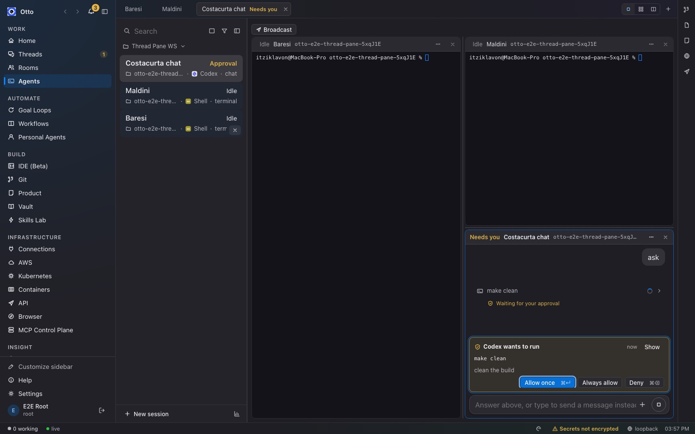

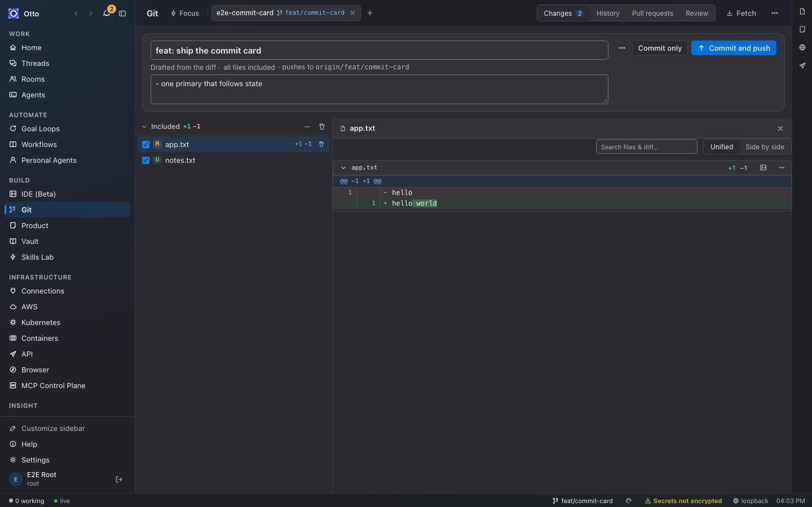

### What's new in 0.4.0

- **Threads, redesigned.** One centred reading column, a composer with one
  primary action (Send, Queue, Steer or Stop), and a sidebar that works as an
  inbox: status in words (Approval, Question, Done, Failed, Limited, Working),
  what needs you first, pins and History that follow you to every device.
  ⌘K opens on the threads that need you. A details card holds the folder,
  branch, one git action (commit, push, pull request, without leaving the
  thread), changes, context use and MCP servers.
- **Several agents and providers under one thread.** Say it in one sentence
  and the thread's agent delegates to subagents on other providers. They show
  as one row, one "Waiting on N subagents · Stop" line and a section in the
  details card; their approvals and questions are answered from the parent,
  and Stop stops the family. Continue any thread on another provider: the
  conversation is handed over and the switch shows in the timeline. Compare
  models side by side.
- **MCP for every agent.** Approvals for governed tools are asked in the
  thread and the waiting call then runs. Each thread lists the servers its
  agent really has and why one is missing. Server questions (elicitation)
  reach you; images and links in results render. Remote servers can use SSE
  and sign in with OAuth (tokens stay in the Keychain).
- **ACP, verified against the installed CLIs.** Live tests per agent, modes
  and models that follow the agent, session resume, "always deny", URL
  questions, and file and terminal calls served through Otto where the agent
  uses them.
- **Review and ship from the thread.** Notes on diff lines sent to the agent
  as one message, a changes card per turn, a new worktree in one step that
  arrives with the files and dependencies `.worktreeinclude` names, a usage
  limit shown as a state with "Resume at reset" or "Continue with another
  provider", and a context meter.
- **Phone and tablet.** Every Threads flow works by touch with the keyboard
  up, in both orientations; Back closes the sheet on top.
- **Fixes.** Links open again everywhere in the desktop app (the terminal
  included), and a selection in an agent's terminal survives until you copy
  it (⌥-drag, then ⌘C or ⌥⌘C).

### What's new in 0.3.0

- **IDE (Beta).** A multi-language IDE inside Otto: local and remote-SSH
  projects, multi-folder projects, SDK and toolchain manager, run and debug
  configurations (DAP), language servers, refactorings, a git gutter, local
  history, dependency and vulnerability views, live shared editing and IDE
  plugins. Chat with an agent about the open project from the IDE itself.
- **Threads: every agent, fully.** Claude, Codex, Antigravity, Gemini, Grok,
  OpenCode, pi and Muse run as structured agents. Each one reports what it
  can do (images, files, plan mode, effort, steering) and Threads offers
  exactly that. Agents name their threads, list their own slash commands and
  report cost and context; tool screenshots show inline; subagents,
  background tasks and Antigravity swarms open from **Agents & tasks**.
- **Agents survive a restart.** A deploy or daemon restart no longer kills a
  running agent: it keeps working in a holder process and the thread picks it
  up again, mid-turn, approvals and queued messages included.
- **Safer by default.** Sandboxed sessions can't reach other sessions'
  agents, shared-editing guests can't write git or agent config, and local
  language servers run only for the Mac's owner.

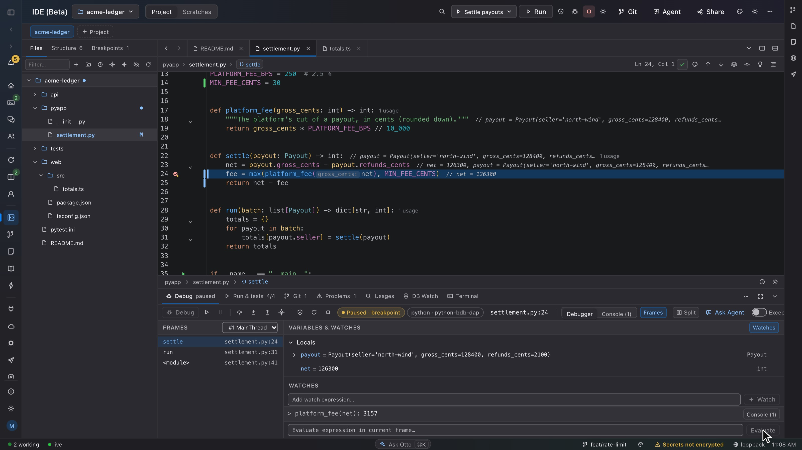

### What's new in 0.2.2

- **Threads: several agents, one conversation.** Ask another agent from inside
  a thread: its answer arrives as a child thread, shown as a live card in the
  parent and nested under it in the sidebar. **Council** sends one prompt to
  two to four agents, shows the answers side by side and synthesizes them. One
  **Related threads** control replaces the Peers tab and the relay bar. A
  session now opens where it lives: a thread opened from ⌘K, a notice or Home
  lands in Threads, and ⌘T on Threads starts a thread.
- **One home per feature.** **Design Hall** is the home for designs (new
  lobby, autosave, versions with compare / restore / approve, export; Canvas
  boards and story attachments are mirrored in and stay read-only until
  **Edit here**). **Skills Lab** holds skills and the evaluator. The **MCP
  Control Plane** holds MCP servers, each running Native or Governed. Product
  **Chat** and **Refine** are one tab.
- **Agents ask first.** An agent can no longer confirm its own destructive
  Kubernetes, AWS, Kafka or database change, turn off a connection's
  Read-only setting, change its own instructions or delivery, post in Slack as
  you, or edit API-client environments without a person. Approval cards show
  where a message goes and its full text. Read-only database connections run
  every statement in the database's own read-only mode.
- **Usage you can trust.** Remaining plan usage per account on the Usage page;
  Codex and Antigravity first-turn tokens are counted with their session
  instead of as "External"; Insights reports follow your local calendar and
  say "not available" instead of 0 for what was not measured.
- **Paths that open.** A file or folder path in a terminal or a thread opens
  from the folder where it really exists; folders open in the side panel or in
  Finder; a path found nowhere says so.
- **Phone.** An opt-in light version with five tabs (Threads, Connections,
  Git, API, Usage) and one tap back to the full app.
- **Git and pull requests.** The PR page is a workspace: PRs as tabs, a
  timeline, per-commit diffs, viewed files, review requests, changes since
  your review, reviewers, merge checks.
- **Your work is kept.** A skill you edited in a CLI's own skills folder is
  backed up instead of overwritten; an external editor's save is no longer
  lost under a Vault save; a Canvas board the Hall cannot copy still opens;
  Workbench "Paste into session" can no longer run what it pastes.
- **Calmer machine.** Background agents wait when the Mac is overloaded, old
  background sessions are archived, and the low-disk warning starts at 10 GB.

See the [0.2.2 release notes](../../releases/tag/v0.2.2) for the full list,
including behaviour changes to know before upgrading.

| Threads — ask another agent | Council — seats side by side, then a judge |
| :---: | :---: |
| 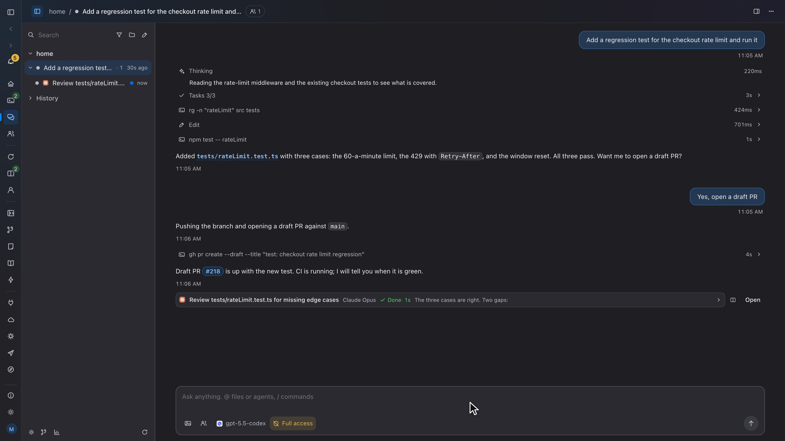 | 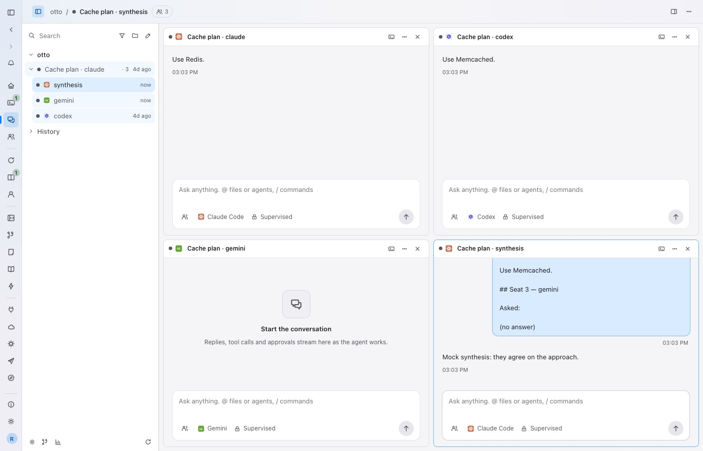 |
| **Design Hall — comments on a design** | **Phone — the light version** |
| 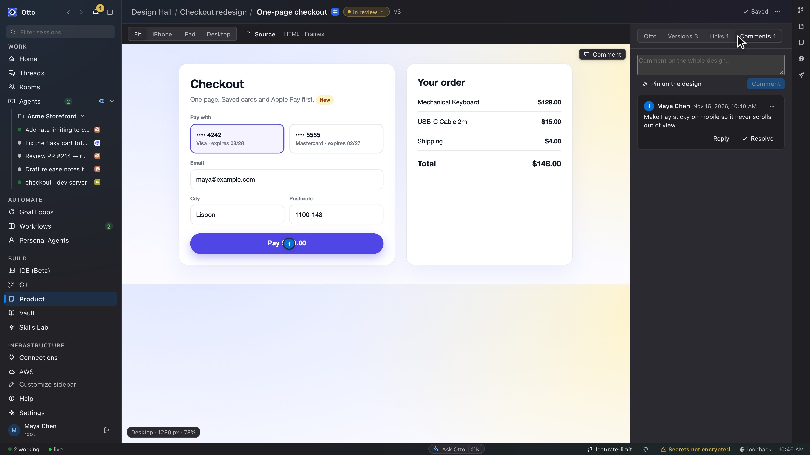 | 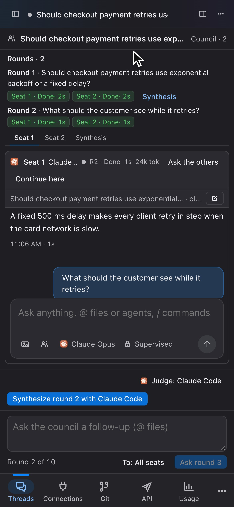 |

### What's new in 0.2.1

- **Threads on structured agent protocols.** Codex, Claude, Antigravity, pi,
  opencode and Muse Code run as structured sessions instead of terminals: plans, commands,
  file edits and test runs stream into the thread, approvals appear inline
  where the agent asks, and threads can open, message and close **linked
  threads**. Thread agents get the Otto MCP tools, can make changes, and can
  drive the UI once you allow it.
- **Personal Agents on Threads.** An agent's runs and its **Chat** tab are
  threads. A **main agent** creates and delegates to a team of agents and
  collects their reports; agent-admin MCP tools set agents up with your
  approval.
- **Slack tools for agents.** `otto.slack_*` reads, searches and digests
  Slack and posts as the bot or as you (one user token per Slack workspace,
  opted in per agent), and can mark a message unread.
- **Phone access over Tailscale.** Serves Otto to your own tailnet only (never
  Funnel), pairs a phone with a QR code you approve on the Mac by a matching
  code, lists and revokes paired phones, and adds **Continue on phone** to
  every session and thread. See `docs/features/phone-access.md`.
- **Database Explorer:** ordinary read-only SQL is no longer refused on
  restricted connections (a refusal shows the reason), and a detected query
  variable can be skipped. The session **Chat** view was removed; the
  conversation view lives in Threads.

| Threads — structured runtime | Threads — inline approval |
| :---: | :---: |
| 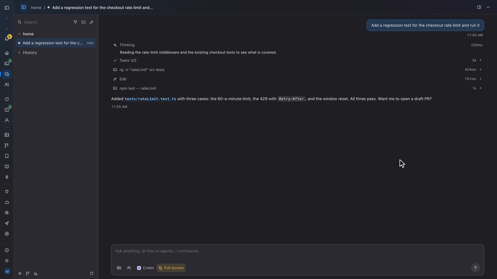 | 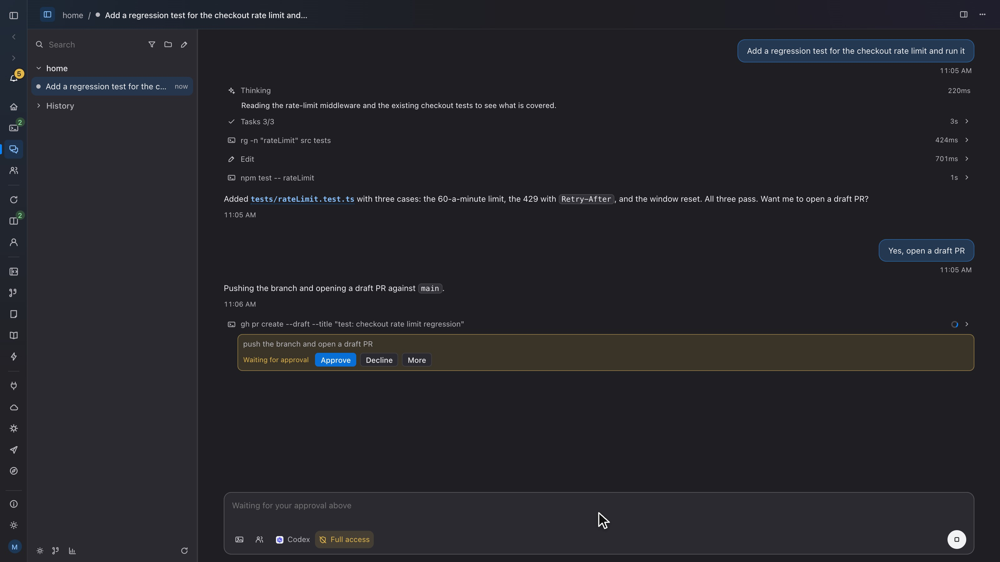 |
| **Personal Agent — Chat on Threads** | **Phone access — Continue on phone** |
| 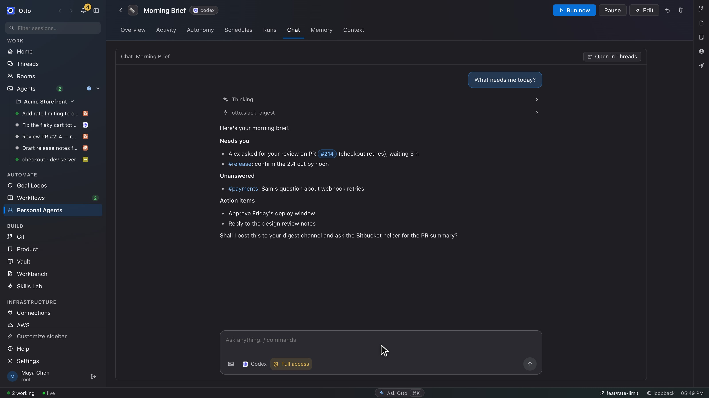 | 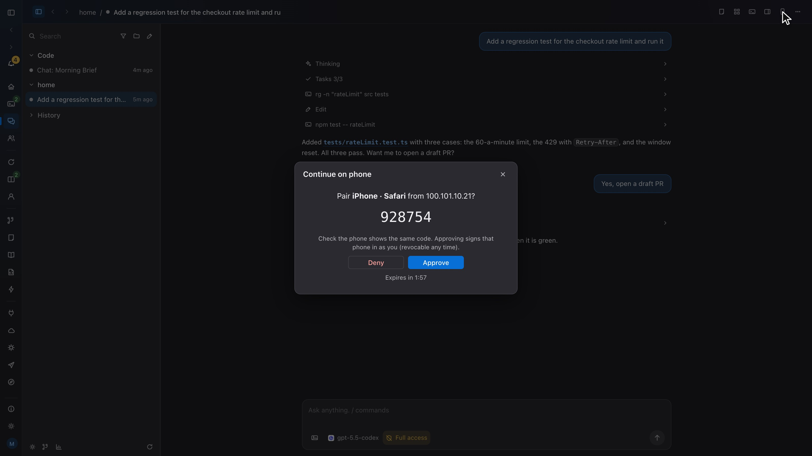 |

### What's new in 0.2

- **Threads (Experimental) — conversational workspace (`#/threads`).** A dedicated
  inbox-style workspace alongside classic terminal **Agents**: `Pinned`,
  `Active`, `Projects` (nested worker trees + branch chips), and `History` in
  the left rail; a `1-up | Split | Grid` multi-session conversation canvas (up
  to 4 live threads side-by-side) with a slide-up PTY terminal drawer; full GFM
  Markdown, inline workspace images with zoomable lightbox, expandable reasoning
  prose across Claude, Codex, and Antigravity (`agy`), `@file` mentions, inline
  permission docks, and **Steer vs Queue** mid-turn composer controls; plus a
  right-hand **Files · Changes · Connections · Peers** inspector with multi-tab
  file preview/source, unified/split diffs, live DB MCP query streams, and
  direct session-to-session messaging.
- **Streamlined sidebar & unified hubs.** **Product** unifies Jira/Confluence
  **Stories**, **Design Hall** (**Designs**), and **Learnings** in one hub;
  **Scheduled Tasks** unifies recurring **Tasks**, **Personal Agents**, and
  **Agent channels** in one hub. Rarely used standalone surfaces were retired
  for a faster, sharper app.
- **Graduated BiDi & Right-to-Left (RTL).** First-strong Unicode paragraph
  direction (`dir="auto"`) across Markdown turns, streaming drafts, and
  composers, with code blocks, diffs, paths, and SQL kept strictly LTR — plus
  full `LTR / RTL` layout support in **Settings → Appearance**.
- **One design system, everywhere.** Shared page headers, loading/empty/error
  states with Retry, Badge, Switch, docked drawers, and resizable panes, backed
  by ~30 automated `ui-guards` ratchets in `npm run check`.
- **Session Rooms**, detachable panes and multi-window, live attributed Agent
  MCP tabs in **Database Explorer**, and an updated **product tour film** in
  **Help → Walkthroughs**.

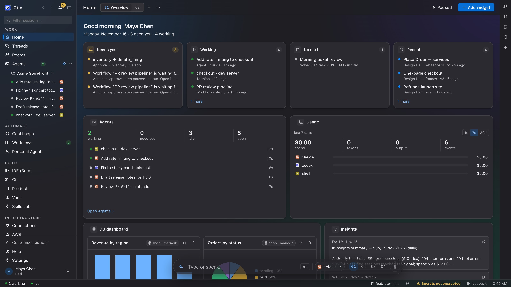

| Threads — 2-up Split + File Viewer | Threads — New Thread Stage |
| :---: | :---: |
| 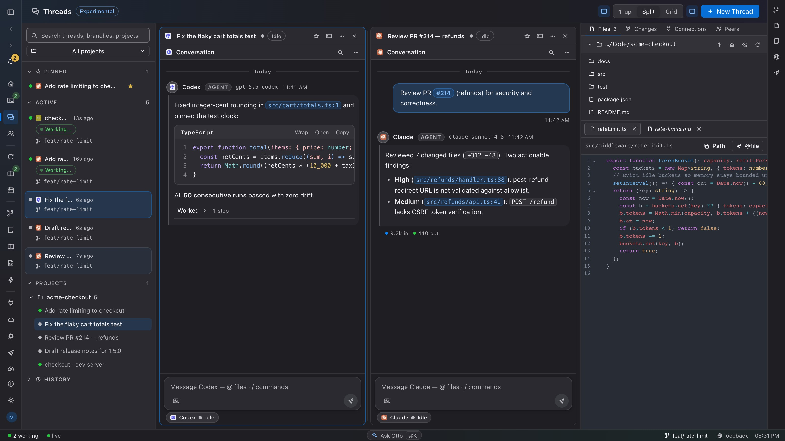 | 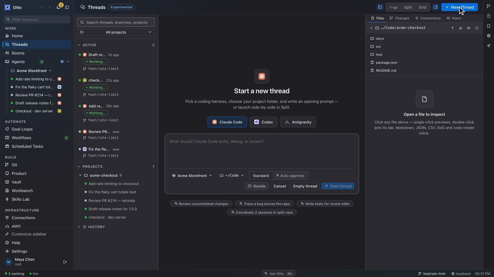 |
| **Git & Multi-Agent AI Code Review** | **Database Explorer & Visual Query Builder** |
| 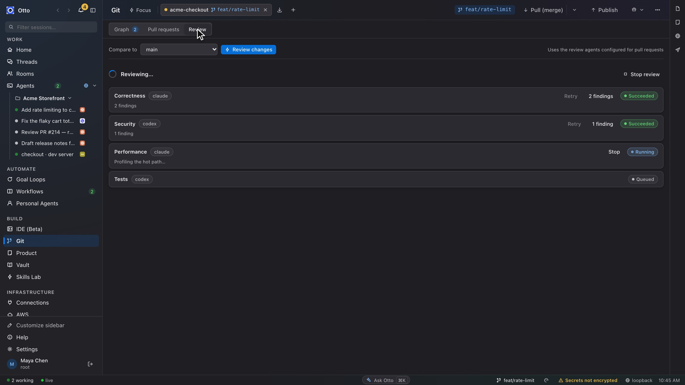 | 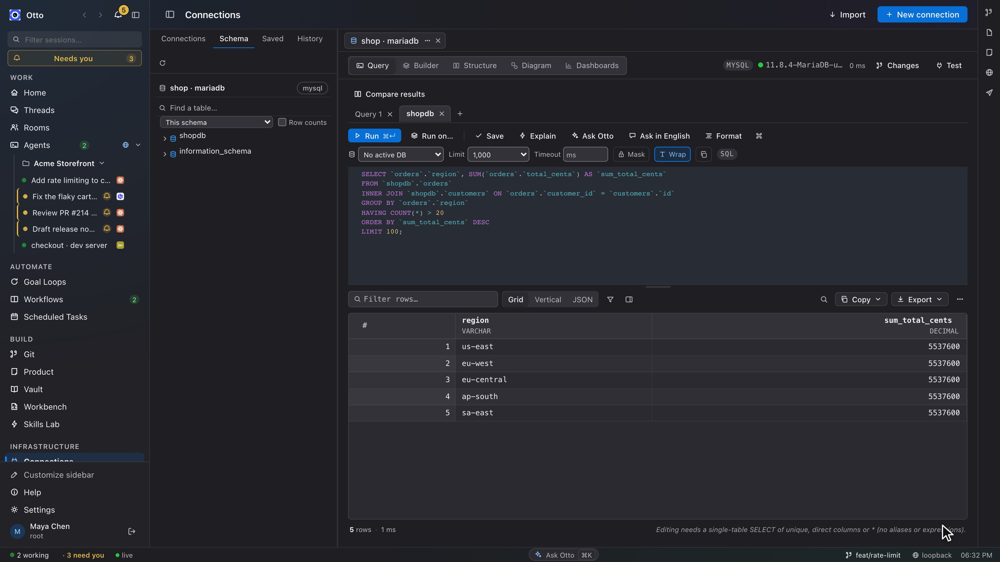 |
| **Unified Product & Design Hall** | **Threads — Light Mode & Diffs** |
| 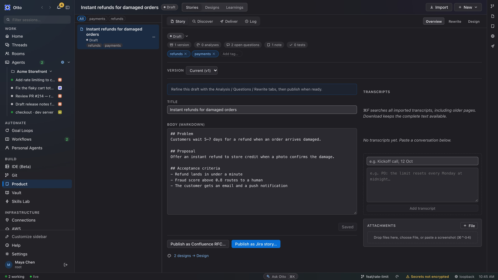 | 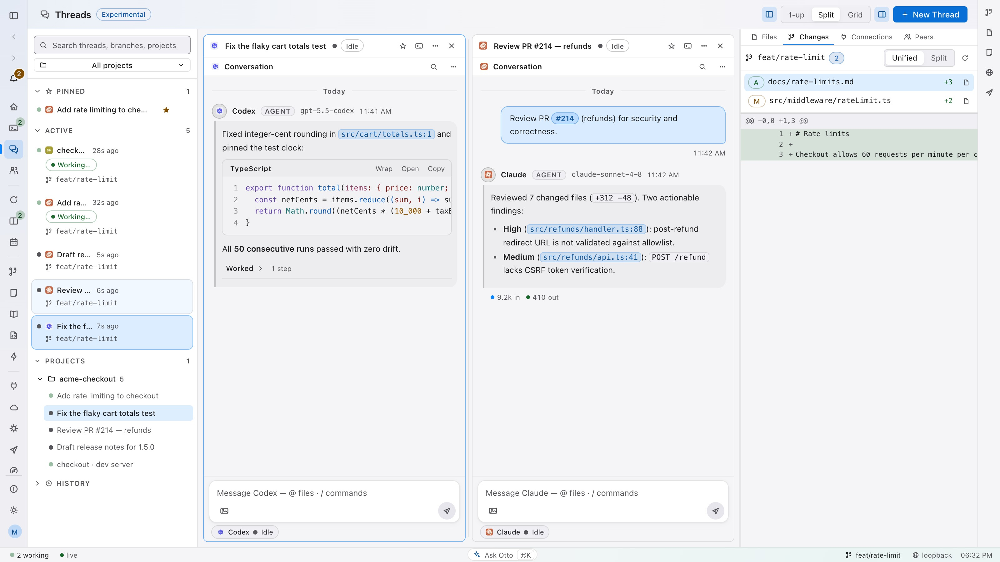 |

---

## Features

- **Threads** — an inbox-first conversational workspace (`#/threads`)
  inspired by modern agentic IDEs while keeping Otto's multi-session power:
  - **Structured runtime:** Codex, Claude, Antigravity, pi, opencode and Muse run
    over their structured protocols (`otto-agent-protocol`), so plans,
    commands, file changes and tool calls are real items, approvals answer
    inline, and threads link into teams (`otto.thread_open` / `_message` /
    `_close`). See `docs/features/threads-structured-runtime.md`.
  - **Inbox & project rail:** `Pinned` threads, `Active` ("needs you" / running)
    threads, `Projects` grouped by workspace/repo with `delegated_by` sub-worker
    nesting and branch chips, and `History`.
  - **Multi-session Split & Grid:** watch and drive 1, 2 (`Split`), or up to 4
    (`Grid`) live agent conversations at once, with an on-demand **Terminal**
    drawer attached to the same underlying PTY.
  - **Rich conversation & composer:** GitHub-flavored Markdown, syntax-highlighted
    code blocks, inline workspace images + zoomable lightbox, expandable
    `Thinking` blocks, inline MCP approval docks, `@file` typeahead, and
    explicit **Steer** (interrupt/nudge now) vs **Queue** (wait for turn end)
    submission.
  - **Several agents in one conversation:** ask another agent from inside a
    thread (its answer arrives as a child thread: a live card in the parent,
    nested under it in the sidebar), or start a **Council**: one prompt to two
    to four agents, each its own thread side by side in Split/Grid panes, and
    a judge (⋯ › Synthesize with) that compares their latest answers.
  - **Workspace inspector (`Files · Changes · Connections`):** multi-tab
    file explorer with rendered Markdown/image preview + source lines, working-tree
    git status + Unified/Split diffs, live `otto_db_query` activity with 1-click
    **Open side-by-side** Database Explorer, and one **Related threads** control
    for message relay, broadcast and **Session Rooms**. File and folder paths in
    a message are links that open where the path really exists.
- **Agent sessions** — run `claude`, `codex`, `agy`, a plain shell, or **any
  custom agent CLI you register** (custom providers are first-class on every
  agent surface, with per-surface provider/model pickers) in real PTY-backed
  terminals you can watch, split, and type into, or open the same session in
  **Threads** for a chat view. Every session can **pin its
  own model** — chosen from a live per-provider **model catalog** (refreshed
  hourly from the providers' docs/CLIs, no API keys needed) — and the pin
  applies to that session only, so switching models never leaks into the next
  session; custom providers declare their model flag via a template
  (`--model {model}`, `-m {model}`, …). Sessions survive restarts
  (resumable), idle-suspend to save memory, and closing a tab asks what you
  mean — keep it running in the background or **archive** it (stops the
  process, keeps the full history, resumable later) — with bulk close/archive,
  reopen-closed-tab (⌘⇧T), and an opt-in auto-archive for long-idle sessions.
  A **tiled grid view** shows every session at once (up to 15 live terminals),
  sessions are auto-titled from what the agent is doing, and a pane-level
  **restart** respawns a stuck session in place, resuming the same conversation.
  Sessions can be confined by an optional macOS **Seatbelt sandbox**
  (`otto-sandbox`) and auto-trust their workspace folder so they never stall
  on a permission prompt. By default agents
  launch in a **skip-permissions** mode (`--dangerously-skip-permissions`, or
  codex's `--dangerously-bypass-approvals-and-sandbox`) so tool use never blocks;
  a single **Settings → Providers → Permissions** checkbox opts out and falls back
  to each CLI's own ask / auto permission mode (tool use then prompts in the
  session terminal). Applies to new sessions.
- **Session Rooms** — turn any live agent session into a real-time collaborative
  room: invite teammates with host admission, talk over WebRTC voice and live
  screen share, draw annotations directly on the shared screen (with permission),
  hand over and reclaim terminal control at any moment, and generate a local
  structured recap (decisions, actions, open questions) once participants consent.
- **IDE (Beta)** — a multi-language IDE (`#/ide`) on your local or SSH
  projects (Go, Java & Spring Boot, Kotlin, Rust, Zig, C/C++ & Unreal Engine, .NET C#/F#, TypeScript/JS & web frameworks, Python & Jupyter notebooks, Shell): language servers
  (`gopls`, `jdtls`, `kotlin-language-server`, `rust-analyzer`, `zls`, `clangd`, `csharp-ls`, `svelteserver`, `vue-language-server`, `ngserver`, `pyright`, `tsserver`), header/source switch (`⌥O`), a git gutter,
  run configurations (CMake/CTest, Meson, Make, Unreal, Go, Cargo, Zig, .NET, Maven/Gradle, pytest, npm/Vitest/Jest/Playwright/Karma) with live output and test trees, a DAP debugger with
  breakpoints, watches, variable editing, PID/core attach, and an agent dock that proposes diffs
  you apply or undo. See `docs/features/ide.md`.
- **Git & Pull Requests** — a GitKraken-style **commit graph** with a WIP row +
  staging panel, per-file diffs, folder-level stage/discard, an interactive
  **conflict resolver** (A/B line picking with live output) that covers merge,
  **rebase, cherry-pick, revert and stash-pop conflicts** alike — conflicted
  files get their own WIP section with ours/theirs quick-resolves, and a dirty
  tree blocking a pull or branch switch offers a one-click
  **stash → pull/switch → restore** instead of a raw git error — check out any
  branch from the graph (Pull is a separate, explicit action),
  **worktrees & submodules** as first-class tabs, auto-fetch, and a **Focus tab** (your PRs across repos +
  your Jira work). **Create PRs** (draft toggle, reviewers at creation) with an
  **agent-drafted title + description** (it reads your branch diff — watch
  the drafting agent live inside the PR dialog), pushing the branch
  automatically; PR review threads support resolve/reply/reopen.
- **AI code review** — fan out several review agents (one per provider/lens)
  over a PR *or* your local working tree. Each runs as an openable session with
  live progress, per-agent findings, per-agent stop / retry, and a configurable
  grace period; lenses are **per-repo presets** built from your installed
  `review` skills.
  Findings become **tracked items** — a review-findings workflow with statuses
  and fix / verify / open-Jira / false-positive / regression-test actions — backed
  by a **Review Proof Pack** (diff, test & CI evidence, risk badges, and human
  sign-off) or saved to workspace memory.
- **Product & Design Hall (Unified Hub)** — one sidebar home with three tabs
  (**Stories · Designs · Learnings**):
  - **Stories (Jira / Confluence):** import a Jira issue or Confluence page and
    run multi-agent, multi-provider **analysis** with open questions you can post
    back as comments, a suggested **rewrite**, **test-case** generation published
    to Confluence, **discovery** drafts, versioning, a **Plan/Tasks** breakdown,
    background comment polling, and rich Confluence HTML publishing.
  - **Designs (Design Hall):** one versioned, linkable artifact graph for UI
    frames, graphics, sites, 3D scenes, whiteboards, and brand kits organised
    into projects, with side-by-side variant comparison and agent design assist.
    See [`docs/features/design-hall.md`](./docs/features/design-hall.md).
  - **Learnings:** recurring product and design rules distilled from your team's
    decisions.
- **Canvas** — think visually. Each canvas scene is **file-backed** in
  **Excalidraw** (`canvas.json`), **Mermaid** (`canvas.mermaid`), or **D2**
  (`canvas.d2`). An agent edits the underlying file while you converse, so
  diagrams evolve live alongside your session. The Canvas page has folded into
  **Design Hall**: boards open there as Whiteboard designs, read-only until you
  press **Edit here** to take one over (the old page is unmounted, not deleted).
  See [`docs/features/canvas.md`](./docs/features/canvas.md).
- **Channels** — bridge a Slack or Telegram thread to an agent session: messages
  (and file attachments) are relayed in, the agent's reply (and any file) is
  relayed back. One agent per ticket, auto-archived when idle.
- **Broadcast & Peer Messaging** — send one literal message to many live agent
  sessions at once (⌘⇧B, no AI in the loop) or relay structured session-to-session
  messages with full sender attribution.
- **Goals** (inside Workflows) — give a **goal**, criteria and a **budget**
  (iterations + active time). An agent works in an isolated worktree (branch
  `otto-wf/<run>`) or a research folder, and a check step decides every
  criterion with evidence — a command, a checker agent, or you — repeating
  until all are met or the run is held (**Paused**, **Blocked**, **Out of
  budget**), where you **Resume** or **Extend and resume…**. Loops made with
  the earlier Goal Loops feature are a read-only history.
- **Connections** — open SSH / MySQL / PostgreSQL / Redis / MongoDB / ClickHouse
  sessions side-by-side with agents. One sidebar entry holds the **unified
  hub**: every connection and Kafka cluster in one folder tree with per-kind
  glyphs and type-filter chips — DB kinds open in the workbench, SSH and Kafka
  as seamless workbench tabs. The SSH username is optional everywhere
  (terminals, DB tunnels, Kafka tunnels): leave it empty and ssh resolves it the
  way your terminal does — `~/.ssh/config` `User`, else your local login name.
- **Database Explorer** — a TablePlus-class browser for MySQL, PostgreSQL, Redis,
  MongoDB, and ClickHouse over plaintext, TLS/SSL, or SSH tunnels: a lazy schema tree,
  per-engine autocomplete, multiple query tabs, a virtualized results grid
  (client-side filter/sort + approval-gated inline editing), a Navicat-style
  visual JOIN builder, Superset-style dashboards/widgets for ClickHouse, and
  "examine this schema with an agent". Read queries get an automatic row `LIMIT`
  so a huge table is never fully scanned, any running query is cancelable, and
  queries **survive navigation** (detached runs you can re-attach to). Closing a
  connection tab **actually disconnects** — the daemon cancels its in-flight
  queries, closes the pooled backend connections, and drops the SSH tunnel — and
  a closed tab stays closed across restarts. The JOIN builder, table designer,
  and index builder generate **engine-correct SQL** per dialect (Postgres
  quoting/ALTERs, ClickHouse `ADD INDEX`/`MODIFY COLUMN`), the grid and schema
  tree are fully keyboard-navigable, and dashboards/widgets are editable in
  place with cancelable streaming export/import. Also: NL→SQL assistance, full
  **mongosh scripts** in the Mongo query tab, **live attributed Agent MCP query
  tabs** whenever an agent queries a database, index management
  (view/create/edit/drop from the Structure view), foreign-key navigation, JSON
  cell/document editing, file import, and streaming CSV/format export.
- **Message Brokers (Kafka)** — connect Kafka clusters (incl. **AWS MSK over an
  SSH bastion**) to browse topics, **peek/produce** messages, inspect
  consumer-group lag, edit topic configs, and view a Schema Registry, with an
  Overview of brokers/partitions/throughput. Supports PLAINTEXT/TLS and SASL
  (PLAIN/SCRAM) auth, prod/read-only guards, and an in-process Kafka-aware proxy
  so a private cluster is reachable through a single SSH tunnel (librdkafka can't
  SOCKS, so Otto rewrites the advertised broker addresses on the fly).
- **AWS console** — S3, SQS, EC2, Athena and EKS in one module, driven through
  the official `aws` CLI v2 (installed on demand — Homebrew or a direct
  download — never a bundled SDK), so SSO/MFA/assume-role profiles just work.
  Accounts are configured in the UI (an existing `~/.aws` profile or access
  keys kept in the Keychain; Otto never writes `~/.aws/*`), each with a
  per-service permission probe and a one-click "Sign in" when an SSO session
  expires. S3 is read-only (browse, preview, download); SQS peek/send/purge/
  redrive; EC2 start/stop/reboot with typed confirms; a DB-Explorer-style
  Athena workbench (catalog tree, results grid, history, scanned-bytes cost);
  EKS clusters importable straight into the Kubernetes console. Six RBAC keys
  (`aws` for accounts, plus `aws_s3`, `aws_sqs`, `aws_ec2`, `aws_athena`,
  `aws_eks`) gate it per service, and agents get read tools plus Edit-gated
  `aws_athena_query` / `aws_sqs_send` over MCP.
- **Kubernetes console** — a k9s-like cluster workspace over `kubectl` (installed
  on demand; kubeconfigs picked from `~/.kube/config`, pasted, or imported from
  EKS into Otto-owned files — your kubeconfig is never modified). Namespace
  filter, health-colored tables over 16 resource kinds with live CPU/MEM when
  metrics-server exists, a detail drawer with manifest (secrets redacted) /
  describe / events / streaming **logs** / an inline **exec** terminal, and
  audited row actions — restart, scale, rollout undo/pause/resume, CronJob
  trigger/suspend, **Argo Rollouts** promote/abort/retry and **ArgoCD**
  sync/refresh/redeploy, all via the CRDs (no extra CLIs); destructive ones
  need a typed confirm. One-click **k9s** tab. Gated by the `kubernetes` RBAC
  key (View/Edit/Admin); agents get `k8s_list_clusters` / `k8s_get_resources` /
  `k8s_describe` / `k8s_logs` / `k8s_top` and the Edit-gated `k8s_action` over
  MCP.
- **Browser** — a workspace-scoped web browser inside Otto: reader tabs fetch a
  URL and render it as clean markdown (JS-rendered pages via a
  [Lightpanda](https://github.com/lightpanda-io/browser) sidecar, beta software,
  with a transparent plain-fetch fallback when it's unavailable), DOM
  annotations you can send into a live session or save as a Vault note, a
  CSS-selector query, one-turn page summarize, and Keychain-backed **Site
  Credentials** an agent can use to sign in only when you've explicitly opted
  the credential in. Five `browser_*` MCP tools give agents the same
  fetch/query/summarize/login pipeline. Every fetch is netguard-checked
  (loopback/private/metadata addresses refused). In the desktop app, tabs can
  flip to **Live** — a real embedded native webview with its own click-to-mark
  overlay — instead of the fetched reader view.
- **Vault — the docs home** — register a local folder of markdown files (even a
  live **Obsidian vault**) and get Obsidian-parity docs in Otto: file tree,
  editor ⇄ reading view with wikilinks/backlinks/tags, full-text search, quick
  switcher, and a graph view built to scale (with focus filters by service,
  type, tag, and hops) — with **OKF** as the documentation standard and every
  note readable/writable by agents over MCP. **Docs agents** can write the docs
  home *for* you: multi-agent create/refine runs over a repo, with a
  summarizer, iterative reviewer rounds, actionable findings, and persistent
  run history. Files stay the source of truth; Otto keeps only a derived index
  (`otto-vault`).
- **Multi-user, RBAC & sharing** — per-feature roles (None < View < Edit <
  Admin), per-workspace membership (grant one account several workspaces from
  a single **By user** screen), per-session isolation, an admin overview +
  audited impersonation, and **session sharing** via scoped, expiring,
  revocable links gated by an email-OTP access code. **Phone access** pairs
  your own phone over **Tailscale** (tailnet-only `tailscale serve`, QR pairing
  approved on the Mac, revocable device tokens, **Continue on phone** from any
  session or thread — `docs/features/phone-access.md`). Optional **remote/mobile
  access** (Cloudflare tunnel + installable PWA) keeps the daemon loopback-only
  by default; copy, paste and keyboard shortcuts work from a remote browser
  even on the self-signed listener. The shell is fully
  **responsive (phone + iPad, portrait & landscape)** with collapsible,
  independently-scrollable sections, **light/dark + RTL**, and an opt-in
  **per-device session view** (show only sessions started on this device). See
  `docs/MULTI-USER-RBAC.md` and `docs/remote-access-runbook.md`.
- **Self-improvement** — an optional, gated engine that reflects on recent
  sessions and proposes edits to the workspace's skills/memory (tiered autonomy:
  safe edits auto-apply, risky ones queue for approval). Can run on multiple
  providers for varied suggestions.
- **Skills library** — a bundled, versioned skill library (`otto-skills`) you
  can browse and install/update in Skills Lab; skills drive review lenses,
  product analysis, and insights, and the self-improvement engine refines them
  from your sessions.
- **Skills Lab** — a three-tab workbench over your skills: a **viewer/editor**
  (multi-file CRUD, zip import, provider skills from `.claude`/`.codex`/`.agy`),
  a **multi-agent skills review** (with an apply-fixes agent and static checks
  for dead citations/paths), and an **evaluator** that benchmarks a skill —
  run **implement → validate → score → improve** across multiple iterations and
  providers, read a per-run report, and compare runs side-by-side to see what
  actually got better.
- **Insights** — scheduled, multi-provider "catch-up" reports that turn recent
  activity into action-first summaries, generated on demand and cached.
- **Usage & cost** — an embedded ClickHouse engine records real per-turn token
  usage and cost by tailing Claude and Codex transcripts (no manual
  instrumentation), with per-provider / day / session rollups and configurable
  retention.
- **API client** — a built-in REST workbench (collections, environments, history,
  automations) that also speaks **GraphQL, SSE, WebSocket and gRPC**, with
  import/export (Postman / OpenAPI / HAR), git sync of Postman collection files,
  a per-workspace cookie jar, Keychain-backed secret variables, open tabs that
  survive app restarts, and an SSRF-guarded executor.
- **MCP Control Plane** — two-way Model Context Protocol. **Inbound:** every agent
  session gets a first-party `otto` MCP server (`ottod mcp-tools`) with read-only
  tools over Otto's own data — including your **database connections**:
  `otto_list_connections`, `otto_db_schema`/`_children`/`_object` (full table
  structure), and `otto_db_query` to **run read-only queries and get rows**. Writes
  and DDL are refused server-side (independent of the connection's write-guard);
  results are row-capped, PII-masked, and audited. On by default; attached to Claude
  via `.mcp.json` and to Codex via per-spawn `-c` overrides. **Outbound:** every MCP
  tool your agents call passes a governance pipeline (allowlist → policy →
  single-use approval → dry-run → fail-closed audit → stats). **Outward:** Otto
  exposes its own `otto.*` tools — across every feature (codebase search, context
  packets, workflows, git/PRs incl. inline + threaded `comment_pr`, issues,
  brokers, product & design, vault, read-only DB, scheduled tasks, AWS,
  Kubernetes, …) — to external MCP clients **over HTTP, not only
  locally**: a **Streamable-HTTP** endpoint (`POST /api/v1/mcp/http`) a client
  connects to with a bearer token, no local subprocess (the `ottod mcp-server`
  stdio bridge still works too). You can mint **multiple scoped tokens** — each
  owned by an Otto **user** and carrying its own permission set (which tools,
  **read-only vs writes**, an optional workspace pin), enforced at the one
  governed choke point — so **different users get different access**. Served on
  loopback always, and reachable from another machine over the opt-in **TLS
  network listener** (or fronted by a tunnel). Manage tokens and the HTTP/network
  settings in **MCP → Otto Server**.
- **Workflows** — a visual workflow engine that chains steps (agent prompts, HTTP
  requests, DB queries, broker peeks, channel notifications, human approvals,
  …) into runnable graphs. Agent steps run as **threads** (provider · model ·
  effort per step), **independent steps run side by side**, and steps that
  need no agent check out a PR, run a script, post review comments or check
  criteria. A **Runs** inbox shows what **needs you**; each run has its own
  page with every step's conversation. Per-workflow instructions +
  `prompt.md` context files, **Retry step**, and a run queue. Runs **survive
  daemon restarts**: finished steps are adopted from the persisted per-node
  state and an interrupted agent step goes on in the same conversation
  (side-effect steps are never blindly re-fired; a per-workflow toggle opts
  out). A comma-separated Working Directory declares a **multi-repo run**.
  Manual, webhook, **chat** (run a workflow from a bound Slack/Telegram
  channel, with one live status message in the thread), **schedule**
  (interval / daily / weekly / cron) and event triggers fire today.
- **Scheduled Tasks & Personal Agents (Unified Hub)** — one sidebar entry with
  three tabs (**Tasks · Agents · Agent channels**):
  - **Tasks:** recurring agent jobs on an **interval / daily / weekly** schedule
    that execute a prompt, write a **Markdown report**, and **deliver** it to
    Slack, Telegram, email, or a webhook (secrets redacted), with full run
    history and `otto.*` MCP tools.
  - **Agents (Personal Agents):** named personas (souls) with a **pinned
    provider + model**, dedicated working folder and **memory notes**, one **or
    more** schedules, optional **browser use** (Playwright MCP), per-agent
    delivery, and a **Chat** tab that is a Threads conversation on the
    structured runtime. A **main agent** can create agents, delegate to them
    and collect their reports; agents can use the `otto.slack_*` tools as the
    bot or as you (per-workspace user tokens, opted in per agent).
  - **Agent channels:** transparent group rooms where personal agents and humans
    post messages persisted and streamed live to the UI.
- **Custom plugins** — extend Otto at runtime with out-of-process **sidecar
  plugins** (any language) you install/enable/remove **without rebuilding**: the
  daemon supervises each plugin process, reverse-proxies its HTTP/UI into an
  iframe panel, exposes a small **scoped host API**, and gates each by slug-keyed
  RBAC. Two real example plugins ship in `examples/plugins/` — **Team
  Performance** (git-primary delivery analytics: per-dev/team reports,
  AI scope estimates, goals) and **DORA metrics** (see
  `docs/plugins/AUTHORING.md`).
- **Multi-window** — open any number of Otto windows (**⌘⇧N**), each an
  independent workspace surface with its own module, tabs, and split panes;
  quitting snapshots the whole window set (frames, screens, fullscreen) and the
  next launch restores it. Sessions live in the daemon — windows only hold
  references, so nothing restarts or duplicates.
- **Snipping tool** — one-gesture screenshots for agent work: a system-wide
  shortcut (default ⌘⌃⇧2) → native region select → an annotation editor
  (boxes, arrows, text, pixelate, badges) — the image is on the clipboard at
  every step, ready to paste into a session.

## Architecture

Otto is a Tauri 2 desktop app with a Rust backend daemon and a Svelte 5 frontend.

```
┌──────────────────────────────────────────────┐
│  Otto.app  (Tauri / otto-desktop)             │
│  ┌───────────────┐      ┌──────────────────┐  │
│  │   Svelte UI   │◀────▶│  ottod (sidecar) │  │
│  │ (ui/, webview)│ HTTP │  127.0.0.1:7700  │  │
│  └───────────────┘  +WS └──────────────────┘  │
└──────────────────────────────────────────────┘
                              │ spawns
        claude / codex / shell (PTY),  git, providers,  aws / kubectl CLIs
```

- **`ottod`** — the daemon: an Axum HTTP+WebSocket server on `127.0.0.1:7700`
  (loopback only by default). Owns sessions, PTYs, git, reviews, channels, and
  state (SQLite). Runs under `launchd` when installed; the desktop app bundles
  it as a sidecar.
- **`ui/`** — the Svelte 5 + Vite + TypeScript frontend, embedded into the app
  at build time. The Rust API (`docs/contracts/`) is the source of truth; the
  TS types mirror it.
- **Rust crates** (`crates/`): `otto-core` (domain/API), `otto-state` (SQLite),
  `otto-sessions` (session manager + PTY + trust + prompt-guard), `otto-pty`,
  `otto-orchestrator`, `otto-git`, `otto-git-cmd`, `otto-issues`
  (Jira/Confluence), `otto-channels`, `otto-connections`, `otto-dbviewer`
  (Database Explorer), `otto-apiclient` (API-client gRPC + scripting + REST
  engines), `otto-brokers` (Kafka viewer), `otto-ssh` (shared SSH-tunnel helper),
  `otto-browser` (in-app browser: reader/live tabs, annotations, Lightpanda
  sidecar engine), `otto-aws` (AWS console — `aws` CLI v2 runner, accounts,
  S3/SQS/EC2/Athena/EKS), `otto-k8s` (Kubernetes console — `kubectl` runner,
  clusters, resources/logs/exec/actions), `otto-vault` (the docs home —
  file-backed markdown vaults + OKF), `otto-memory` (workspace memory layer),
  `otto-product` (Jira/Confluence story workflows), `otto-design` &
  `otto-design-assist` (Design Hall artifact graph & agent assist),
  `otto-assistant` (Personal Agents engine & scheduler), `otto-automation`
  (Scheduled Tasks + Goal Loops), `otto-rooms` (Session Rooms), `otto-review`
  (AI code-review engine), `otto-transcript` (Claude/Codex/Antigravity
  transcript folder), `otto-improve` (self-improvement), `otto-insights`,
  `otto-usage` (ClickHouse usage/metrics), `otto-skills` (bundled skill
  library), `otto-context`, `otto-rbac`, `otto-netguard` (SSRF guard),
  `otto-sandbox` (macOS Seatbelt confinement for spawned agent/shell sessions),
  `otto-keychain` (macOS Keychain secret storage), `otto-canvas` (Canvas
  scenes), `otto-mcp` (MCP control plane + governance), `otto-workflows`,
  `otto-server` (routes), `ottod` (binary).

## Download (prebuilt DMG)

The [latest release](../../releases/latest) has `Otto_<version>_aarch64.dmg`
(Apple Silicon) and its `.sha256`. Open the DMG and drag **Otto** to
`/Applications`. Older versions are on the [releases page](../../releases).
The rolling `latest` build that the retired monthly workflow made is no longer
updated.

**First launch.** From 0.6.1 on, releases are signed with an Apple Developer ID
and notarized by Apple: macOS asks once whether to open an app downloaded from
the internet, and opens it. The DMGs of 0.6.0 and earlier are not notarized, so
macOS blocks their first open.
- **macOS 15 and later:** open Otto once, then click **Open Anyway** in
  **System Settings ▸ Privacy & Security**. Control-click ▸ Open no longer
  bypasses Gatekeeper there.
- **macOS 12–14:** Control-click ▸ **Open**.
- **Either:** run `xattr -dr com.apple.quarantine /Applications/Otto.app` once.

**Updates.** The DMGs published so far, 0.6.0 included, do not update
themselves: download the next one from the releases page. From the first
Apple-signed release on, a release build finds new releases by itself
(**Otto ▸ Check for Updates…** and the sidebar) and installs them when you
restart it.
- A build from source never updates itself: pull and run
  `packaging/deploy.sh`.
- Switching from a source build to a release build changes the signing
  certificate. macOS therefore asks once more for Accessibility, Screen
  Recording and Microphone, and the Keychain asks once to let `ottod` read its
  key.

The DMG does not bundle the in-app walkthrough videos; they stream from the
`walkthroughs` GitHub release.

## Prerequisites

- **macOS** (Apple Silicon or Intel). Otto uses launchd, the macOS Keychain, and
  codesigning, so it is macOS-only today.
- **Rust** (stable) — <https://rustup.rs>
- **Node.js 20+** and npm
- **CMake** — compiles the bundled `librdkafka` (the Kafka/Message Brokers
  driver) from source: `brew install cmake` (macOS) / `apt-get install cmake`
  (Linux). Build-from-source only — installing the prebuilt `.dmg` does **not**
  need it (librdkafka is already compiled into the shipped binary).
- **Tauri CLI** — `cargo install tauri-cli` (or `npm i -g @tauri-apps/cli`)
- **git**
- At least one **agent CLI** on your `PATH`, e.g.:
  - [Claude Code](https://docs.anthropic.com/claude/docs/claude-code) (`claude`)
  - Codex (`codex`)

  Otto detects which are installed and lets you pick a default; you don't need
  all of them.
- **Optional tools install on demand from inside the app** — ClickHouse
  (Usage & cost), Lightpanda (JS-rendered Browser pages), the `aws` CLI v2
  (AWS console) and `kubectl` / `k9s` (Kubernetes console). None are needed to
  build or to launch Otto.

## Build from source

```bash
git clone <your-fork-url> otto && cd otto

# 1. Frontend → ui/dist
cd ui && npm ci && npm run build && cd ..

# 2. Daemon (release)
cargo build --release -p ottod

# 3. Bundle the daemon as the app's sidecar (Tauri externalBin)
cp target/release/ottod \
   apps/desktop/src-tauri/binaries/ottod-$(rustc -vV | sed -n 's/host: //p')

# 4. Build the desktop app
cd apps/desktop/src-tauri && tauri build --bundles app
#   → target/release/bundle/macos/Otto.app
```

### Code signing (local / self-signed)

macOS requires the app and its sidecar to be signed. For local use you can use a
self-signed identity:

```bash
packaging/make-cert.sh          # creates a self-signed "Otto Dev Signing" identity (once)
packaging/sign.sh /path/to/Otto.app /path/to/ottod
```

Published releases are signed by CI with the release certificate instead
(see [docs/RELEASE.md](docs/RELEASE.md)). `packaging/dmg.sh` builds a
distributable `.dmg`, and
`packaging/com.otto.daemon.plist` is the launchd template for running `ottod`
in the background.

## Development

Run the daemon and the Vite dev server separately for hot-reload:

```bash
# Terminal 1 — daemon on http://127.0.0.1:7700
cargo run -p ottod

# Terminal 2 — UI on http://localhost:5173 (talks to the daemon)
cd ui && npm run dev
```

The frontend's API base defaults to `http://127.0.0.1:7700`; override it in the
browser console with `localStorage.otto_base = 'http://127.0.0.1:7700'` if needed.

Useful checks:

```bash
cargo build --workspace            # Rust build
cargo test --workspace             # Rust tests
cargo clippy --workspace --all-targets -- -D warnings   # lints (CI-enforced)
cd ui && npm run check              # svelte-check + tsc (+ the e2e tsconfig)
cd ui && npm run test:e2e          # Playwright mobile/tablet E2E
```

The **E2E suite** (`ui/e2e/`, Playwright) spins up an **isolated throwaway daemon**
(temp data dir + port — it never touches your real sessions/DBs), serves the live
UI via Vite, and drives every page across five device profiles (iPhone & iPad,
**portrait + landscape**, plus a small phone). It asserts real behaviour — pages
fit the width and scroll, sections collapse, and core flows work (DB query →
results, Git commit → diff, terminal output/input) — and runs the same checks in
**light/dark** and **RTL**. The mobile shell is collapsible-section based and
touch-readable.

## Configuration & secrets

- **First run** prompts you to set a root password (local accounts), then add
  workspaces (folders), agent defaults, and git/issue/channel accounts in
  **Settings**.
- **Secrets never live in the repo or in plain files.** Tokens (git, Slack,
  Telegram, Jira, connection passwords) are stored in the **macOS Keychain** via
  `otto-keychain`; the daemon DB only stores opaque key references.
- The daemon listens on **loopback only** unless you explicitly enable a network
  listener in settings (it then also binds `0.0.0.0` over **TLS**, self-signed) —
  which is also how the MCP HTTP transport becomes reachable from another machine.

## Project layout

```
crates/         Rust workspace (daemon + libraries)
apps/desktop/   Tauri desktop shell (otto-desktop)
ui/             Svelte 5 + Vite frontend
packaging/      sign.sh, dmg.sh, make-cert.sh, deploy.sh, launchd plist
examples/plugins/ Example sidecar plugins (Team Performance, DORA)
docs/contracts/ API + WebSocket contracts (source of truth for the TS types)
docs/features/  Per-feature guides (setup, walkthrough, API, limits)
docs/design/    Build contracts for in-flight modules (AWS + Kubernetes consoles)
docs/plugins/   Plugin authoring guide
marketing/      Remotion sources for the in-app walkthrough videos
.github/workflows/ CI gates + the tag-driven signed release (release.yml)
```

## Documentation

Every feature above has a dedicated, **code-grounded** guide under
**[`docs/features/`](./docs/features/README.md)** — setup (incl. token/account
and Slack-manifest steps), a full walkthrough, the relevant REST/WS surface,
explicit capabilities & limitations, security notes, and troubleshooting. Start
at the **[features index](./docs/features/README.md)**.

Where everything lives:

| Doc | What it is |
|-----|------------|
| **[Feature guides](./docs/features/README.md)** | One in-depth guide per feature — the definitive reference. Start here. |
| [`docs/contracts/`](./docs/contracts/) — [`api.md`](./docs/contracts/api.md), [`ws.md`](./docs/contracts/ws.md), [`product.md`](./docs/contracts/product.md) | The REST + WebSocket contracts. **Authoritative** for the API shape; the TS types in `ui/src/lib/api/types.ts` mirror them. |
| [`docs/MULTI-USER-RBAC.md`](./docs/MULTI-USER-RBAC.md) | Operator runbook: per-feature roles, isolation, impersonation, API tokens. |
| [`docs/remote-access-runbook.md`](./docs/remote-access-runbook.md) | Operator runbook: reaching Otto from a phone/iPad — Cloudflare tunnel, PWA, share links, email-OTP. |
| [`docs/RELEASE.md`](./docs/RELEASE.md) | The macOS packaging flow — sidecar copy, Tauri build, codesigning, DMG. |
| [`docs/plugins/AUTHORING.md`](./docs/plugins/AUTHORING.md) | How to write a custom sidecar plugin (the host API, manifest, examples). |
| [`docs/design/aws-k8s-consoles.md`](./docs/design/aws-k8s-consoles.md) | The build contract the AWS + Kubernetes consoles were implemented against (engines, RBAC grid, routes, MCP tools). |
| [`marketing/videos/`](./marketing/videos/) | The Remotion source for the in-app **Walkthroughs** (rendered to `marketing/videos/out/`, published to the `walkthroughs` GitHub release by `packaging/publish-walkthroughs.sh` — not bundled). |

The architecture overview lives in the [Architecture](#architecture) section
above and in [`AGENTS.md`](./AGENTS.md); the feature guides and
`docs/contracts/` are the sources of truth.

## Contributing

Issues and PRs welcome. Please run `cargo test --workspace`,
`cargo clippy --workspace --all-targets -- -D warnings`, `cd ui && npm run check`, and
(for UI changes) `cd ui && npm run test:e2e` before opening a PR. The Rust API in
`docs/contracts/` is authoritative — keep the TypeScript types in
`ui/src/lib/api/types.ts` in lockstep.

## License

Released under the [MIT License](./LICENSE).
