# Goal Loop templates and execution graphs

Seven suggested templates turn a concrete goal into an editable draft with three dependent tasks and acceptance criteria. They give the work a starting structure; the criteria and evidence decide whether it is complete.

## Choose and edit a template

Open **Goal Loops → New goal loop**. The **Execution** selector offers **Goal loop** and **Engineering graph** in the same module. Choose a suggested template and enter the concrete outcome you want. The example is a placeholder, not an executable goal. Selecting a template creates a local draft without calling a provider. It does not launch work.

Edit the summary, acceptance criteria, task instructions and dependencies before launching. Proof of concept offers **Backend**, **Frontend** or **Both**. Research creates a research loop; the other templates create build loops and require a repository.

Templates respect the selected execution type. **Goal loop** works toward the whole goal each iteration; its interactive phase diagram shows Plan → Execute → Evaluate → Digest and the feedback path. Select a phase for a short explanation. The live view marks the current phase without implying unobserved phases ran.

**Engineering graph** runs one ready task per iteration after its prerequisites pass. The visible diagram draws arrows from prerequisites to dependent tasks. Select a task to edit its instructions, dependencies and linked criteria; in a saved run, selection opens its status and recorded evidence. Branching arrows describe dependencies, not parallel execution. Tab and arrow keys move between task buttons; Enter or Space selects. Phone layouts keep nodes readable, with scrolling inside large diagrams.

Switching an edited graph to **Goal loop** asks for confirmation and keeps its task structure in the current draft. Switching back restores those edits. A saved standard loop persists the whole-goal mode; unsaved cached graph edits are not part of that run. **Work type** separately chooses Build or Research. List cards and run details identify the execution type explicitly.

Regenerating a draft with an agent replaces its task plan after confirmation. Old tasks do not carry into regenerated criteria. If you remove criteria while using whole-goal mode, switching back drops those old links and asks you to associate any now-unassigned tasks explicitly.

## How graph execution works

The suggested graphs use the exact IDs `task-1`, `task-2`, `task-3`, associated with `c1`, `c2`, `c3`. Research also attaches `otto-research-report` to the final task, so its report must remain on disk. Each task depends on the preceding task. Otto executes one ready task per iteration, serially in the retained working directory; these diagrams do not imply parallel executor sessions.

Each task passes through the goal-loop planning, execution, evaluation and digest phases. Dependencies control readiness. Repairing an earlier task invalidates its dependent tasks, so a prior downstream result cannot establish completion for changed work. All goal criteria still need evidence, and template drafts enable the independent completion review.

The diagrams show the successful path. A missing criterion, requested decision, failed review or exhausted budget does not follow the success edge. See [Goal Loops](./goal-loops.md) for lifecycle controls, human verification, recovery and proof.

## Suggested templates

| Template | Three graph tasks | Initial time cap |
| --- | --- | --- |
| [Angular feature](#angular) | Trace the feature → Implement the feature → Verify the UI | 90 minutes |
| [Go feature](#go) | Trace the contract → Implement and test → Verify affected consumers | 75 minutes |
| [General engineering](#general) | Understand the change → Implement the change → Review and verify | 75 minutes |
| [Research](#research) | Collect evidence → Compare options → Write the recommendation | 60 minutes |
| [Proof of concept](#poc) | Define the experiment → Build the runnable slice → Evaluate feasibility | 90 minutes |
| [Rewrite](#rewrite) | Inventory behavior → Migrate a slice → Verify parity | 120 minutes |
| [Performance](#performance) | Measure the baseline → Optimize the cause → Compare and review | 90 minutes |

Each template starts with **5 iterations**, a **20-minute per-phase timeout**, and **3 executor recovery attempts**. These are editable bounds, not a promise of completion. No monetary cap is set. Local commits are off; template constraints keep changes local and do not authorize staging, commits, push, publishing or messages.

All initial criteria use **Agent assessment**. Replace or supplement them with concrete **Command** checks or **Human verification** where appropriate. A suggested instruction to run a check is not proof that it ran. Missing material checks remain unmet.

<a id="angular"></a>
### Angular feature

Trace the API and state flow, implement the feature, and verify production behavior and visuals.

Example goal: Add a status filter to the orders page, using the existing customers filter as the reference.



[D2 source](../diagrams/goal-loop-angular.d2) · [SVG](../diagrams/goal-loop-angular.svg)

| Acceptance | Evidence to inspect |
| --- | --- |
| The feature contract and reference implementation are recorded. | Cite the actual API, state and view paths, the reference screen and the agreed success/error behavior. |
| The requested user flow works through the real API and state path. | Exercise the intended flow and a realistic failure; explain why the regression check fails before the change. |
| Production compilation, critical checks and visual acceptance pass. | Record exact commands/results and observed reference-aligned layouts, responsive behavior and degraded states. Unavailable material checks remain unmet. |

<a id="go"></a>
### Go feature

Follow the handler, service and data boundaries, then verify behavior and failure paths.

Example goal: Add tenant-scoped pagination to the audit endpoint without changing existing response fields.



[D2 source](../diagrams/goal-loop-go.d2) · [SVG](../diagrams/goal-loop-go.svg)

| Acceptance | Evidence to inspect |
| --- | --- |
| The request, response and data boundaries are explicit. | Cite actual code and consumers, tenant scoping and realistic failure behavior. |
| The requested behavior and critical failure paths work. | Run focused tests covering the original defect or missing behavior and the changed boundary. Record commands and output. |
| Affected consumers and repository checks pass. | Record repository, revision, commands and results. Resolve concrete high/medium findings or leave this criterion unmet. |

Use the repository’s prescribed commands. For a workflow with a defined Go PR-gate script, preserve its once-per-repository-and-revision contract, omitted-check records and scope restrictions. Do not replace a missing script with an unrequested broader suite.

<a id="general"></a>
### General engineering

Inspect the causal path, make a cohesive change, and independently verify the result.

Example goal: Make export stream rows instead of buffering the full result, while preserving the CSV contract.



[D2 source](../diagrams/goal-loop-general.d2) · [SVG](../diagrams/goal-loop-general.svg)

| Acceptance | Evidence to inspect |
| --- | --- |
| The causal scope and acceptance checks are grounded in current code. | Cite affected paths and consumers, expected behavior and a concrete way to falsify an incorrect implementation. |
| The requested behavior is implemented with meaningful regression coverage. | Exercise the actual changed path, including the important failure case, and show the test distinguishes the old behavior. |
| Final review and relevant checks support completion. | Record commands, outcomes and finding dispositions. Missing material verification or open high/medium issues leaves the criterion unmet. |

<a id="research"></a>
### Research

Gather primary evidence, compare options, and write a decision-ready report.

Example goal: Compare three streaming approaches for the export service and recommend one against our memory and compatibility constraints.



[D2 source](../diagrams/goal-loop-research.d2) · [SVG](../diagrams/goal-loop-research.svg)

| Acceptance | Evidence to inspect |
| --- | --- |
| Relevant primary evidence and constraints are recorded. | Check cited sources support each key fact and identify important evidence gaps. |
| Options are compared against explicit decision criteria. | Trace the comparison back to evidence and show why rejected options fail or cost more under the stated constraints. |
| A cited, actionable report answers the research question. | Inspect the retained report, citations and unresolved limitations; ensure the recommendation or insufficient-evidence conclusion follows from the evidence. |
| The research report is retained on disk. | Inspect findings.md in the research directory. |

<a id="poc"></a>
### Proof of concept

Test one feasibility question with a runnable slice and a clear result.

Example goal: Prove that an SSE feed can update the dashboard within one second for 100 connected clients.



[D2 source](../diagrams/goal-loop-poc.d2) · [SVG](../diagrams/goal-loop-poc.svg)

| Acceptance | Evidence to inspect |
| --- | --- |
| The backend and frontend experiment has measurable success and failure conditions. | Inspect the experiment plan, target workload or user flow, assumptions and a concrete way the hypothesis could fail. |
| The backend and frontend experiment runs with documented setup. | Run the documented setup and the main flow. Record what is real versus mocked and capture the meaningful failure behavior. |
| The feasibility result is supported by observed evidence. | Compare actual observations with the original conditions; record limitations and the next decision. A demonstrated or falsified hypothesis is valid; unsupported claims or an unexecuted experiment remain unmet. |

Backend focuses on the actual endpoint and storage/integration boundary; Frontend focuses on the interaction, responsive layout and explicit mocks; Both follows the interaction through the API boundary. Report what is real, mocked and outside production scope. A supported feasibility decision does not claim production readiness.

<a id="rewrite"></a>
### Rewrite

Inventory behavior, migrate a bounded slice, and compare old and new behavior.

Example goal: Replace the export implementation while preserving every documented format and error response.



[D2 source](../diagrams/goal-loop-rewrite.d2) · [SVG](../diagrams/goal-loop-rewrite.svg)

| Acceptance | Evidence to inspect |
| --- | --- |
| The behavior matrix and migration boundary are recorded. | Compare the matrix with actual code, callers and assertions; identify compatibility and performance constraints. |
| The replacement slice preserves the required behavior. | Run the same meaningful inputs and failure cases against old and new implementations; report differences explicitly. |
| Behavior parity and relevant performance comparisons support migration. | Record completed matrix entries, exact regression commands and comparable performance results. Missing required parity stays unmet. |

Populate the parity matrix from the original implementation and tests. The template is deliberately for a bounded migration slice; selecting it does not establish whole-product parity.

<a id="performance"></a>
### Performance

Measure a representative workload, optimize the observed cause, and compare results.

Example goal: Reduce export peak memory for one million rows while keeping throughput and output unchanged.



[D2 source](../diagrams/goal-loop-performance.d2) · [SVG](../diagrams/goal-loop-performance.svg)

| Acceptance | Evidence to inspect |
| --- | --- |
| A reproducible baseline identifies the measured bottleneck. | Inspect raw measurements, workload and environment. Include CPU/RAM versus concurrent work where relevant; do not substitute a source guess for profiling. |
| The change addresses the measured cause without changing required behavior. | Trace the causal improvement and run the relevant correctness and failure checks. |
| Comparable measurements demonstrate the requested improvement. | Record baseline/after values, commands, environment and correctness results. A missed target, incomparable run or material regression remains unmet. |

Choose the target, workload and environment from the actual goal. The template does not supply a universal latency, throughput or memory threshold. Compare equivalent runs and preserve correctness.

## Skills and evidence

Templates do not install skills or assume a dedicated graph-engineering skill exists. Their Skills field starts empty. Add existing general review/research skills or domain skills when the installed provider and repository support them. Angular and Go implementation skills may encode project-specific conventions; inspect their applicability before using them in another repository. Missing skills or source access remain visible limitations.

The template choices reflect recurring local work patterns: contract tracing before edits, meaningful regression checks, separate visual verification, bounded review/fix rounds, measured performance and explicit rewrite parity. Research and POC emphasize supported decisions and honest limitations. Private session material is not part of the repository documentation.

## Maintain these artifacts

The UI definitions in `ui/src/modules/loops/templates.ts` are the template source. Keep task labels, dependencies and criterion IDs aligned when changing these diagrams. Each `.d2` file is editable source; its `.svg` is the rendered artifact. From the repository root, render an updated diagram with:

```sh
d2 fmt docs/diagrams/goal-loop-angular.d2
d2 --layout=dagre docs/diagrams/goal-loop-angular.d2 docs/diagrams/goal-loop-angular.svg
```

Repeat for the changed family. The diagrams describe suggested task order plus completion review; [API contracts](../contracts/api.md#goal-loops) remain authoritative for transport and lifecycle behavior.
